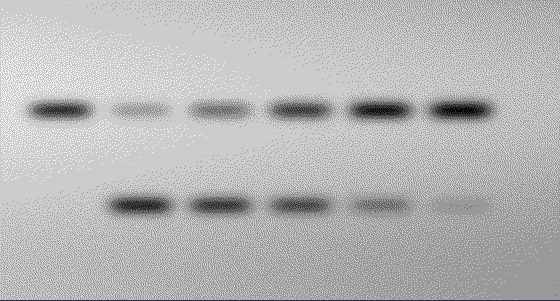
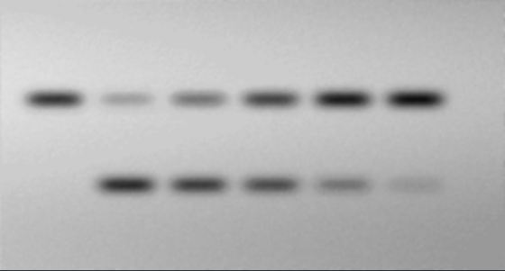

# Densi-assist User Manual

**English** · [한국어](USER_MANUAL.ko.md) · [日本語](USER_MANUAL.ja.md) · [简体中文](USER_MANUAL.zh-CN.md)

Densi-assist measures the intensity of bands in gel and western blot images and turns it into numbers.
It runs in a web browser, and **images are never sent to any server — everything is processed on your own computer.**
You can open it from a web address, or use it without installing anything by **double-clicking the `Densi-assist.html` file**.

- Version: 0.3
- Recommended browsers: Chrome, Edge (latest version)

> **About the screen language**
> The app's screens are in Korean. In this manual, on-screen labels are written **in Korean exactly as they appear**, followed by an English translation in parentheses — for example **분석** (Analyze). Look for the Korean text on screen.

---

## Contents

1. [Workflow at a glance](#1-workflow-at-a-glance)
2. [Screen layout](#2-screen-layout)
3. [Adding images](#3-adding-images)
4. [① Select — check the image](#4--select--check-the-image)
5. [② Lane — set up lanes](#5--lane--set-up-lanes)
6. [③ Band — set up bands](#6--band--set-up-bands)
7. [Baseline — set the floor line](#7-baseline--set-the-floor-line)
8. [Viewing results and exporting to Excel](#8-viewing-results-and-exporting-to-excel)
9. [Working with multiple images](#9-working-with-multiple-images)
10. [Saving and opening](#10-saving-and-opening)
11. [Keyboard shortcuts](#11-keyboard-shortcuts)
12. [Tips for good results](#12-tips-for-good-results)
13. [FAQ](#13-faq)
14. [Glossary](#14-glossary)

---

## 1. Workflow at a glance

```
Add images → ① Select → ② Lane → ③ Band → Results
```

| Step | What you do | Required |
|---|---|---|
| Add images | Drag and drop gel images (several at once is fine) | ✔ |
| ① **이미지 준비** (Prepare image) | Check the band color (dark/light) and image adjustment (gamma, smoothing) | ✔ (mostly automatic) |
| ② **레인** (Lane) | Draw lanes, or use **레인 검출 (Auto)** (Detect lanes) | ✔ |
| ③ **밴드** (Band) | Draw bands, or use **밴드 검출 (Auto)** (Detect bands); adjust tilt | ✔ |
| Baseline | Choose how the floor line under the bands is drawn | The default (Rolling ball) is usually enough |
| **결과** (Results) | Check area and %, export to Excel | ✔ |

Fastest route: **add images → ② 레인 → 레인 검출 (Auto) → ③ 밴드 → 밴드 검출 (Auto) → 결과 tab**

---

## 2. Screen layout

```
┌──────────────────────────────────────────────────────────────────────────┐
│ Densi-assist  [project]    [ A ]                 ↶ ↷   [ B ]   ?         │
├──────────────────────────────────────────────────────────────────────────┤
│ C  image strip:  [thumb] [thumb] [thumb] ...                [+]          │
├──────────────────────────────────────────────────────────────────────────┤
│ D  (1)━━(2)──(3)──(4)    "To do now: ..."            [ Next → ]          │
├───────────────────┬──────────────────────────────────────────────────────┤
│                   │ [▢][▦]                                               │
│                   │ ──────────────────────────────────────────────────── │
│        H          │                                              [ E ]   │
│   settings panel  │              image with lanes and bands              │
│                   │                                              [ F ]   │
│                   │ ──────────────────────────────────────────────────── │
│                   │              G  (profile graph)                      │
└───────────────────┴──────────────────────────────────────────────────────┘
```

| Area | On screen | Description |
|---|---|---|
| **A** Tabs | **분석** / **결과** | **Analyze** (measuring) and **Results** (tables, charts, export) |
| **B** Project menu | **프로젝트 ▾** | Add images, new project, save/open, demo |
| **C** Image list | **이미지 N** | Images you added. Click one to open it. Double-click a name to rename it |
| **D** Step bar | **1 이미지 준비 › 2 레인 › 3 밴드 › 4 결과** | Prepare image › Lane › Band › Results. Click a large step or the blue **다음** (Next) button to move on. The current step is blue, finished steps get a green check, and a **지금 할 일** (To do now) line tells you what to do. Panel H opens that step's items |
| — Image view | | Lanes (magenta, blue when selected) and bands (orange) are drawn on the image |
| **E** Original view | **원본 이미지 보기** | Top right of the image. Hides lanes and bands so you can compare with the original (key **O**) |
| **F** Zoom buttons | | Bottom right of the image: zoom out, zoom in, fit to screen, 1:1 actual size |
| **G** Profile graph | | Intensity along the selected lane from top to bottom. One peak = one band |
| **H** Settings panel | | Click a heading to open or close it. All are closed at first |
| ↶ ↷ | | Undo / redo (Ctrl+Z / Ctrl+Shift+Z) |

The settings panel (H) is grouped as: **1. 이미지 준비** (Prepare image) → **① 이미지** (Image) / **2. 레인** (Lane) → **② 배경 제거** (Background removal), **③ 레인** (Lanes) / **3. 밴드** (Band) → **④ 베이스라인** (Baseline), **⑤ 밴드 · 타깃** (Bands · Targets).

> New to the app? Use **프로젝트 ▾ → 데모 프로젝트 만들기** (Create demo project), or **데모 프로젝트로 둘러보기** (Explore with demo project) on the start screen, to open a project with three sample images.

---

## 3. Adding images

**Method 1.** On the start screen, drag files onto the dashed box, or click the box to choose files.
**Method 2.** While working, click **+ 추가** (Add) in the image strip at the top, or drop files anywhere in the window.
**Method 3.** Paste a copied image (screen capture, copied from another program, or an image file copied in Explorer) with **Ctrl+V** in the app window. Screenshots are usually 8-bit, so original TIFF files give more accurate quantification. Instead of the keyboard, you can click the **복사한 이미지 붙여넣기** (Paste copied image) button on the start screen, or the same item in the project menu. If the browser asks for clipboard access, choose Allow.

- You can add several images at once.
- Supported formats: **TIFF** (8/16/32-bit, multi-page), **PNG** (including 16-bit), **JPG**, BMP

| Format | Recommendation |
|---|---|
| Original **16-bit TIFF** from the imager | ◎ Best. Both faint and strong bands are measured accurately |
| 8-bit TIFF / PNG | ○ Usable |
| JPG | △ Compression changes pixel values, so it is not recommended for quantification (a warning is shown) |

> Lanes must run **vertically**. Rotate images with horizontal lanes before adding them.

---

## 4. ① Select — check the image

After you add an image you start at **① 이미지 준비** (Prepare image). The original and the **image used for measurement** are shown side by side, and changing the **① 이미지** (Image) settings on the left (band color, color → gray, tilt, gamma, smoothing) updates the right-hand image immediately. Bands are read as **brighter = larger value**, and this image is used for all calculations in ② Lanes, ③ Bands and ④ Results. When you are ready, click **다음: 레인 잡기** (Next: Lanes) at the top right.

### Band color

| Option on screen | When to use |
|---|---|
| **밝은 배경에 어두운 밴드** (Dark bands on a light background) | Coomassie/silver stains, most chemiluminescence images (**default, suggested automatically**) |
| **어두운 배경에 밝은 밴드** (Light bands on a dark background) | Fluorescence images |
| **어두운 밴드, 광학 밀도(OD)로 변환** (Dark bands, convert to optical density) | Film scans, transmitted-light scans |

A suitable option is suggested as soon as the image is added, so you can usually leave it as is.

### Image adjustment (gamma · smoothing)

- **감마 (밝기 조절)** (Gamma, brightness): changes the brightness curve so faint bands are easier to see. 1 is the original brightness.
- **부드럽게 (노이즈 제거)** (Smoothing, noise removal): a blur (0–3 px) that reduces dotted patterns and noise.
- The **측정에도 적용** (Apply to measurements) check box next to each slider is on by default, so bands are measured on the adjusted image. Turn it off to apply the change to the display only.
- **배경 제거된 이미지로 보기** (View background-removed image): shows the result of ② Background removal on screen.

> **If gamma is applied to measurements**, the ratios between bands can differ from the real ratios of the amounts. For that reason, when gamma is not 1 the results and the Excel file carry a note. For accurate comparisons keep gamma at 1 or turn the check box off.

#### Smoothing before / after

This image was reduced to 16 gray levels and shows a dotted (dithering) pattern. Images copied from PowerPoint or screenshots are sometimes this rough. Left: **0**, right: **1.5 px**.

| Smoothing 0 (before) | Smoothing 1.5 px (after) |
|---|---|
|  |  |

> **Note**: larger values can reduce the area of narrow bands (about 3–6% at 1.5 px on a sample image). Process all images of one comparison with **the same value**. The setting is recorded on the Excel "설정" sheet. Whenever possible, use the original TIFF for the most accurate results.


### Image tilt correction

If the whole image is slightly rotated, you can rotate it by −10° to +10° (**기울기 보정**, tilt correction).

---

## 5. ② Lane — set up lanes

Click **② 레인** (Lane) at the top. Two buttons appear next to it.

| Button | What it does |
|---|---|
| **레인 그리기** (Draw lanes) | Drag on an empty part of the image to draw a lane. A single click adds a lane of the same size as the selected lane at that spot |
| **레인 검출 (Auto)** (Detect lanes) | Finds lanes automatically, including lanes that touch each other and size-marker (ladder) lanes |

### Moving and resizing lanes

You can do this right away without switching tools.

- **Move**: drag the inside of a lane. Hold **Shift** while dragging to move horizontally only.
- **Resize**: hover over the top, bottom, left or right edge of a lane until the cursor changes to an arrow, then drag. Only that edge moves.
- **Delete**: select the lane and press **Delete**, or use the trash icon in the ③ Lanes table on the left.
- **Next/previous lane**: **← →** keys.

### ③ 레인 (Lanes) settings (left panel)

| Item on screen | Description |
|---|---|
| **레인 폭** (Lane width) | Adjust the width with the slider |
| **모든 레인 크기를 같게** (Make all lanes the same size) | When on, changing the width or height of one lane changes all lanes (recommended) |
| **양옆 가장자리 제외** (Exclude side edges) | Measures only the middle of the lane, leaving out a percentage at both sides. Useful when band ends are smeared or curved (shown as dotted lines on the image) |
| **레인 폭 방향 값 합치기** (Combine values across lane width) | **평균** (Mean): average of the pixels in each row (usual) / **중앙값** (Median): less affected by dust and spots |
| **샘플 이름** (Sample name) | Type in the table, or use **엑셀에서 붙여넣기** (Paste from Excel) to paste a whole column at once (from the leftmost lane) |
| **제외** (Exclude) | Checked lanes are left out of the results |

> **Sample names matter.** On the Results tab, **lanes with the same name are grouped**, and the mean and standard deviation are calculated. Lanes from different images are grouped too if their names match.

### ② 배경 제거 (Background removal, optional)

Use this only when the **whole** image has strong stains or shading. Usually leave it on **사용 안 함** (Off) and rely on the baseline.

- Choose Rolling ball or Paraboloid
- **반경** (Radius): larger than the widest band
- **잡티 무시** (Ignore specks): smooths out small dust and noise first

---

## 6. ③ Band — set up bands

Click **③ 밴드** (Band) at the top. Two buttons appear next to it.

| Button | What it does |
|---|---|
| **밴드 그리기** (Draw bands) | On the image: drag **up/down** inside a lane / on the graph below: drag **left/right** |
| **밴드 검출 (Auto)** (Detect bands) | Finds the bands in all lanes automatically |

### Adjusting bands

| What you want | How |
|---|---|
| Move a band | Drag the band up or down on the image |
| Change a band's range | Drag its top or bottom edge on the image, or drag the vertical lines on the graph left or right |
| **Band tilt** | Select a band and **two circles** appear above its ends. Drag the left or right circle up or down to slant the band |
| Enter tilt as a number | The **기울기** (Tilt) column in the ⑤ Bands · Targets table on the left (height difference between the left and right ends, in px) |
| Delete a band | Select it and press **Delete** |

> **Tilt is set for each band separately.** When bands run at a slant on an SDS-PAGE gel, matching the tilt makes the measurement follow that direction, so peaks do not smear and results are more accurate. The black line in the graph below changes to match the tilt.

### Reading the profile graph

```
 Intensity
   │        ╭╮
   │   ╭╮   ││        ← black line: intensity along the lane
   │  ╱  ╲ ╱  ╲
   │─○────○────○───   ← orange dotted line: baseline (floor line); ○: band start/end points
   └──────────────── top of lane → bottom
        band 1  band 2    orange-filled area = band area
```

- The image strip above the graph is the selected lane laid on its side, so positions line up with the graph.
- Each peak shows the band number and **% (its share within that lane)**.
- Hover over the graph to see position, profile, baseline and signal values at the top right.
- **전체 레인 비교** (Compare all lanes): shows small graphs of every lane side by side. Useful for checking that the baseline is drawn similarly in each lane.

### ⑤ 밴드 · 타깃 (Bands · Targets, left panel)

- Band table for the selected lane: **#**, **기울기** (Tilt), **면적** (Area), **% 레인** (% of lane)
- **표 복사** (Copy table): copies this lane's table → paste into Excel
- **겔 전체 복사** (Copy whole gel): copies the bands of every lane in this image at once
- **구간 → 모든 레인** (Ranges → all lanes): copies this lane's band ranges to all other lanes
- **타깃** (Target, protein name): create a name with **+ 타깃**, select a band, then click the target — it is assigned **to all bands at the same height at once**. Double-click a target name to rename it. Targets are used in the per-sample summary on the Results tab.
- **자동 검출 민감도** (Auto-detection sensitivity): controls whether faint bands are found and where band ends are placed.

---

## 7. Baseline — set the floor line

The **baseline** is the **floor line** under the bands in the graph. The area above it is the band value (area).

> **Background removal vs. baseline**
> - ② Background removal: removes stains and shading from the **whole image** (optional).
> - ④ Baseline: sets the floor line in the graph **for each lane** (always used).

Open **④ 베이스라인** (Baseline) on the left and choose a method (**방법**).

| Method on screen | Description | When |
|---|---|---|
| **Rolling ball / disk (1D)** (default) | Rolls a ball along the underside of the graph; its path is the baseline | Most cases |
| **Top-hat** | Shaves off peaks with a flat bar | Background is almost flat |
| **Rubber band** | Like a rubber band stretched under the graph | Bands are reasonably well separated |
| **SNIP** | Shaves peaks with a gradually widening window | Many bands of varying width |
| **이동 중앙값 + Gaussian** (Moving median) | Median over a wide window | Sparse bands with lots of noise |
| **수동 (밴드 시작·끝점)** (Manual: band start/end points) | Joins each band's start and end points with a straight line | You want to set the baseline yourself |
| **없음** (None) | Baseline is 0 | Background has already been removed well enough |

When you choose a method, a **이럴 때** (When to use) and **주의** (Caution) note is shown with it.

### Rolling ball "ball size"

A ball that is too small reaches into the peaks and **cuts away part of the band**; one that is too large **leaves background behind**.
Set it **larger than the widest band**. It is set as a percentage of the lane length, and the actual px value is shown next to it.

### Drawing the baseline manually

1. Choose **수동 (밴드 시작·끝점)** as the method, or click **수동으로 다듬기** (Refine manually) above the graph.
   - "Refine manually" uses the current automatic baseline as a starting point and switches only that lane to manual.
2. The **circles** at both ends of each band in the graph become larger.
3. Drag a circle:
   - **horizontally** → band start/end position
   - **vertically** → floor height at that point
4. **Right-click** a circle to return that point's height to automatic (the valley value at that position).

> A manual baseline joins two points with a **straight line**. Switching from Rolling ball (a curve) may change the area slightly.

### Where to apply

- **이 겔 전체** (This entire gel): the same method for all lanes in this image
- **선택한 레인만** (Selected lane only): a different method for one lane
- **모든 겔에 같은 설정** (Same settings for all gels): applies to every image in the project (to keep results consistent)

### Where the baseline is above the graph

- **0으로 계산** (Count as 0, recommended): negative parts count as 0
- **빼서 계산** (Subtract): negative parts are added as they are

---

## 8. Viewing results and exporting to Excel

Click the **결과** (Results) tab at the top.

### All bands

Bands from every image appear in one table: **이미지** (Image), **레인** (Lane), **샘플** (Sample), **밴드** (Band), **타깃** (Target), **기울기** (Tilt), **면적** (Area), **% 레인** (% of lane).

- Click a column heading to sort.
- Click a row to jump to that band on the Analyze screen.
- Saturated bands are marked **포화** (Saturated) — their value may be lower than the true value.

| Button | Result |
|---|---|
| **엑셀** (Excel) | An `.xlsx` file. Sheets: per-sample summary (when available), bands (including position, Rf, height, Volume), and **settings** (file information and all analysis settings — a record for reproducing the same results later) |
| **CSV** | A CSV file that keeps Korean text intact |
| **표 복사** (Copy table) | Copies to the clipboard → paste straight into Excel |

### Per-sample summary (when targets are assigned)

- Lanes with the same sample name are combined: **mean ± standard deviation (n = number of lanes)**
- Choose a **기준 샘플** (Reference sample) to also show **relative values (×)** with the reference = 1 (for example, fold change versus Control)
- Bar chart: bar = mean, dots = individual lane values, line = standard deviation

### Area and % of lane

| Value | Meaning |
|---|---|
| **면적** (Area) | The area above the baseline: the lane-width average summed from top to bottom |
| **% 레인** (% of lane) | Share of the total band area in that lane |
| Volume (Excel) | Area × lane width used (px). Corresponds to integrated density |

---

## 9. Working with multiple images

You can analyze several gels from one experiment together in **one project**.

1. Add all the images.
2. Click **▦** (grid view) at the top to see every image with its lanes and bands on one screen.
3. Click **모든 겔 자동 분석** (Auto-analyze all gels) to find lanes and bands in all images at once.
4. Check the lane positions and **sample names** in each image. Give the same sample **exactly the same name**.
5. To use the same processing settings everywhere, use **이 겔의 처리 설정을 모든 겔에 복사** (Copy this gel's processing settings to all gels) at the bottom of ⑤ Bands · Targets.
6. For gels loaded in the same layout, use **레인 배치를 다른 겔로 복사** (Copy lane layout to another gel) in ③ Lanes to copy lane positions and sample names.
7. View and export the values of all images together on the Results tab.

---

## 10. Saving and opening

### Auto-save

Your work is **saved automatically in this browser** (the top bar shows **브라우저에 저장됨**, "Saved in browser"). You can close the window and continue later.

> If you clear site data in the browser's "Clear browsing data", the auto-saved work is deleted too. Save important work as a file, as described below.

### Project file (.densi)

In the **프로젝트 ▾** (Project) menu:

| Menu item | What it does |
|---|---|
| **프로젝트 파일로 저장** (Save as project file) | Downloads the original images and all settings as a single `.densi` file. Use it to move work to another computer or share it with colleagues |
| **프로젝트 파일 열기…** (Open project file…) | Opens a `.densi` file (you can also drop it onto the window) |
| **저장된 프로젝트 열기…** (Open saved project…) | Opens or deletes other projects auto-saved in this browser |
| **새 프로젝트** (New project) | Starts an empty project |

---

## 11. Keyboard shortcuts

| Key | Action |
|---|---|
| **V** / **L** / **B** | ① Select / ② Lane / ③ Band |
| **Esc** | Back to ① Select |
| **← →** | Previous / next lane |
| **Delete** | Delete the selected band (or the lane if no band is selected) |
| **O** | Toggle the original image view |
| **F** | Fit the image to the screen |
| Mouse wheel | Zoom in / out |
| **Space** + drag, middle/right mouse button drag | Pan |
| **Shift** + drag a lane | Move horizontally only |
| **Ctrl+Z** / **Ctrl+Shift+Z** (Ctrl+Y) | Undo / redo |
| **1** / **2** | Analyze / Results tab |

---

## 12. Tips for good results

1. **Use the original 16-bit TIFF.** JPGs and screenshots have altered values.
2. **Avoid saturation.** A saturated band has its top clipped and is measured lower than it really is. If you see the **포화** (Saturated) mark, retake the image with a shorter exposure.
3. **Keep all lanes the same width.** Turn on **모든 레인 크기를 같게**.
4. **Use one baseline method.** For images you compare, use the same method with **모든 겔에 같은 설정**.
5. **Make the ball big enough.** If the Rolling ball size is smaller than the bands, the bands get cut. Use **전체 레인 비교** to check that the baseline runs under the bands.
6. **Match the tilt of slanted bands.** The correct tilt is the one that makes the peak sharpest.
7. **Toggle the original image (O)** to hide lanes and bands and check positions against the original.
8. **Name samples accurately.** Only lanes with the same name are grouped in the results.

---

## 13. FAQ

**Q. Can I use it without installing anything?**
A. Yes. Double-click **`Densi-assist.html`** (or `index.html`) in the program folder and it opens in Chrome or Edge. The whole program is inside this one file, so you can copy just this file and use it.
Work is auto-saved in the browser even when you open it as a file, but for important work keep a `.densi` file with **프로젝트 ▾ → 프로젝트 파일로 저장**.

**Q. I opened the file and it says "이미지 처리 모듈을 불러오지 못했습니다" (Could not load the image processing module).**
A. The browser blocked some features of a page opened as a file. Open it with the latest Chrome or Edge, or use the company website address instead.

**Q. I changed the gamma but the measured values did not change.**
A. That is expected. Gamma and brightness only affect the display. See [section 4](#4--select--check-the-image).

**Q. 레인 검출 (Auto) finds the wrong lanes.**
A. First check that the **band color** setting in ① Image is correct. If it is still off, drag the lanes into place or draw them yourself. For gels with almost no gap between lanes, draw one lane with **레인 그리기**, then **click once** at each neighboring position to add lanes of the same size quickly.

**Q. Too many (or too few) bands are detected.**
A. In ⑤ Bands · Targets, raise the **자동 검출 민감도 → 작은 밴드도 찾기** (Auto-detection sensitivity → Also find small bands) value to find fewer, or lower it to find more. Select any unwanted band and press **Delete**.

**Q. What is the unit of the area value?**
A. It is a relative unit that depends on the image and exposure. Interpret it as a comparison within the same image, or as a value relative to a reference sample.

**Q. Are my images uploaded to a server?**
A. No. All processing happens in the browser on your computer. Only the program files are downloaded and run.

**Q. I deleted something by mistake.**
A. Press **Ctrl+Z** (or ↶ at the top) to undo. Right after a deletion you can also use the **되돌리기** (Undo) button in the notification.

---

## 14. Glossary

| Term | Meaning |
|---|---|
| Lane (레인) | A vertical track where one sample ran |
| Band (밴드) | A horizontal stripe in a lane where protein/DNA has collected and appears dark |
| Profile (프로파일) | The intensity curve measured along a lane from top to bottom |
| Baseline (베이스라인) | The floor line under the bands in the profile. The area above it is the band value |
| Area (면적) | The area of a peak above the baseline |
| % of lane (% 레인) | Share of the total band area within one lane |
| Saturation (포화) | So strong that it reached the maximum the camera can measure. Measured lower than the true value |
| Target (타깃) | A protein name attached to bands, used when grouping results |
| Reference sample (기준 샘플) | The sample set to 1 when calculating relative values (e.g. Control) |
| Size marker / ladder (사이즈 마커) | A lane of standard bands with known molecular weights |
