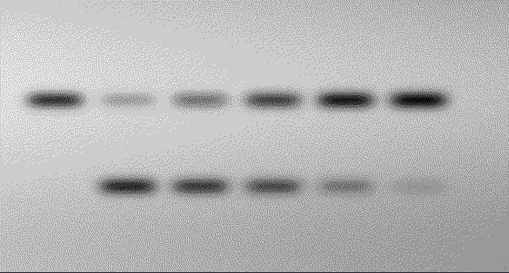
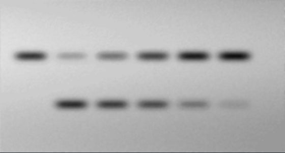

# Densi-assist ユーザーマニュアル

[English](USER_MANUAL.en.md) · [한국어](USER_MANUAL.ko.md) · **日本語** · [简体中文](USER_MANUAL.zh-CN.md)

Densi-assist は、ゲル・ウェスタンブロット画像のバンドの濃さ（intensity）を数値化するプログラムです。
Web ブラウザで動作し、**画像はどのサーバーにも送信されず、すべて自分のパソコンの中で処理されます。**
Web サイトのアドレスから開くことも、インストールせずに **`Densi-assist.html` ファイルをダブルクリック**して使うこともできます。

- バージョン：0.3
- 推奨ブラウザ：Chrome、Edge（最新版）

> **画面の言語について**
> アプリの画面は韓国語です。このマニュアルでは、画面の表示を**画面どおりの韓国語**で書き、その後ろのかっこ内に日本語訳を付けています（例：**분석**（分析））。画面では韓国語の表示を探してください。

---

## 目次

1. [作業の流れ](#1-作業の流れ)
2. [画面構成](#2-画面構成)
3. [画像の追加](#3-画像の追加)
4. [① 選択 — 画像の確認](#4--選択--画像の確認)
5. [② レーン — レーンの設定](#5--レーン--レーンの設定)
6. [③ バンド — バンドの設定](#6--バンド--バンドの設定)
7. [ベースライン — 基線の設定](#7-ベースライン--基線の設定)
8. [結果の確認とExcelへの書き出し](#8-結果の確認とexcelへの書き出し)
9. [複数の画像をまとめて扱う](#9-複数の画像をまとめて扱う)
10. [保存と読み込み](#10-保存と読み込み)
11. [ショートカットキー](#11-ショートカットキー)
12. [良い結果を得るためのヒント](#12-良い結果を得るためのヒント)
13. [よくある質問](#13-よくある質問)
14. [用語集](#14-用語集)

---

## 1. 作業の流れ

```
画像の追加 → ① 選択 → ② レーン → ③ バンド → 結果
```

| ステップ | 行うこと | 必須 |
|---|---|---|
| 画像の追加 | ゲル画像をドラッグ&ドロップ（複数枚可） | ✔ |
| ① **이미지 준비**（画像の準備） | バンドの色（暗い/明るい）と画像の補正（ガンマ・スムージング）を確認 | ✔（ほぼ自動） |
| ② **레인**（レーン） | レーンを描く、または **레인 검출 (Auto)**（レーン検出） | ✔ |
| ③ **밴드**（バンド） | バンドを描く、または **밴드 검출 (Auto)**（バンド検出）、傾きの調整 | ✔ |
| ベースライン | バンドの下の基線の求め方を選ぶ | 既定値（Rolling ball）で十分 |
| **결과**（結果） | 面積・% を確認し、Excel に書き出す | ✔ |

最短の手順：**画像の追加 → ② 레인 → 레인 검출 (Auto) → ③ 밴드 → 밴드 검출 (Auto) → 결과 タブ**

---

## 2. 画面構成

```
┌──────────────────────────────────────────────────────────────────────────┐
│ Densi-assist  [project]    [ A ]                 ↶ ↷   [ B ]   ?         │
├──────────────────────────────────────────────────────────────────────────┤
│ C  image strip:  [thumb] [thumb] [thumb] ...                [+]          │
├──────────────────────────────────────────────────────────────────────────┤
│ D  (1)━━(2)──(3)──(4)    "To do now: ..."            [ Next → ]          │
├───────────────────┬──────────────────────────────────────────────────────┤
│                   │ [▢][▦]                                               │
│                   │ ──────────────────────────────────────────────────── │
│        H          │                                                      │
│   settings panel  │              image with lanes and bands              │
│                   │                                              [ E ]   │
│                   │ ──────────────────────────────────────────────────── │
│                   │              G  (profile graph)                      │
└───────────────────┴──────────────────────────────────────────────────────┘
```

| 領域 | 画面の表示 | 説明 |
|---|---|---|
| **A** タブ | **분석** / **결과** | **分析**（測定作業）と**結果**（表・グラフ・書き出し） |
| **B** プロジェクトメニュー | **프로젝트 ▾** | 画像の追加、新規プロジェクト、保存・読み込み、デモ |
| **C** 画像リスト | **이미지 N** | 追加した画像。クリックでその画像に移動。名前をダブルクリックで名前の変更 |
| **D** ステップバー | **1 이미지 준비 › 2 레인 › 3 밴드 › 4 결과** | 画像の準備 › レーン › バンド › 結果。大きく表示されたステップか、青い **다음**（次へ）ボタンをクリックして進みます。現在のステップは青、完了したステップは緑のチェック、横に **지금 할 일**（今やること）が表示されます。左パネル H ではそのステップの項目だけが開きます |
| — 画像表示 | | レーン（マゼンタ、選択すると青）とバンド（オレンジ）が画像に重ねて表示されます |
| **E** 拡大・縮小ボタン | | 画像の右下：縮小、拡大、画面に合わせる、1:1 原寸。マウスホイールでも拡大・縮小できます。拡大した画像は**マウスの右ボタンを押したままドラッグ**して動かします（初めて拡大すると黄色い案内が出ます） |
| **G** プロファイルグラフ | | 選択したレーンを上から下へたどって測った濃さ。山ひとつがバンドひとつ |
| **H** 設定パネル | | 見出しをクリックすると開閉します。最初はすべて閉じています |
| ↶ ↷ | | 元に戻す / やり直し（Ctrl+Z / Ctrl+Shift+Z） |

設定パネル（H）の構成：**1. 이미지 준비**（画像の準備）→ **① 이미지**（画像） / **2. 레인**（レーン）→ **② 배경 제거**（背景除去）、**③ 레인**（レーン） / **3. 밴드**（バンド）→ **④ 베이스라인**（ベースライン）、**⑤ 밴드 · 타깃**（バンド・ターゲット）。

> 初めての方は **프로젝트 ▾ → 데모 프로젝트 만들기**（デモプロジェクトを作成）、または最初の画面の **데모 프로젝트로 둘러보기**（デモプロジェクトで見てみる）で、サンプル画像 3 枚入りのプロジェクトを開いてみてください。

---

## 3. 画像の追加

**方法 1.** 最初の画面の点線の枠にファイルをドラッグ&ドロップするか、枠をクリックしてファイルを選びます。
**方法 2.** 作業中は、画面上部の画像リストの **+ 추가**（追加）をクリックするか、ウィンドウのどこにでもファイルをドロップします。
**方法 3.** コピーした画像（画面キャプチャ、他のプログラムからのコピー、エクスプローラーでコピーした画像ファイル）をアプリ画面で **Ctrl+V** で貼り付けます。キャプチャ画像は通常 8-bit なので、定量には元の TIFF を使うほうが正確です。 キーボードの代わりに、最初の画面の **복사한 이미지 붙여넣기**（コピーした画像を貼り付け）ボタン、またはプロジェクトメニューの同名項目でも貼り付けられます。ブラウザがクリップボードへのアクセスを求めたら「許可」を選びます。

- 複数枚を一度に追加できます。
- 対応形式：**TIFF**（8/16/32-bit、マルチページ）、**PNG**（16-bit を含む）、**JPG**、BMP

| 形式 | おすすめ度 |
|---|---|
| イメージャー出力の **16-bit TIFF** | ◎ 最もおすすめ。薄いバンドも濃いバンドも正確に測れます |
| 8-bit TIFF / PNG | ○ 使用可能 |
| JPG | △ 圧縮で画素値が変わっているため、定量にはおすすめしません（警告が表示されます） |

> レーンは**縦方向**である必要があります。横向きに撮影した画像は、追加する前に回転してください。

---

## 4. ① 選択 — 画像の確認

画像を追加すると **① 이미지 준비**（画像の準備）から始まります。元の画像と**補正後の画像**が並んで表示され、左の **① 이미지**（画像）の設定（カラー→白黒、傾き、ガンマ、スムージング、背景除去）を変えると右の画像がすぐに変わります。右は元の画像にこれらの設定を反映した姿で、② レーン、③ バンド、④ 結果のすべての計算に使われます。**밴드 색**（バンドの色）は計算にだけ使われる設定なので、画面は元の画像のように見えます。準備ができたら右上の **다음: 레인 잡기**（次へ：レーン）をクリックします。

### バンドの色

| 画面の選択肢 | 使う場面 |
|---|---|
| **밝은 배경에 어두운 밴드**（明るい背景に暗いバンド） | CBB・銀染色、ほとんどの化学発光画像（**既定・自動で推奨**） |
| **어두운 배경에 밝은 밴드**（暗い背景に明るいバンド） | 蛍光画像 |
| **어두운 밴드、광학 밀도（OD）로 변환**（暗いバンド、光学濃度（OD）に変換） | フィルムのスキャン、透過光スキャン |

画像を追加した時点で自動的に推奨されるので、ほとんどの場合そのままで構いません。

### 画像の補正（ガンマ・スムージング）

- **감마 (밝기 조절)**（ガンマ・明るさ調整）：薄いバンドが見やすくなるよう明るさの曲線を変えます。1 が元の明るさです。
- **부드럽게 (노이즈 제거)**（スムージング・ノイズ除去）：点模様やノイズを減らすぼかし（0〜3 px）です。
- 各スライダー右の **측정에도 적용**（測定にも適用）チェックは初期値でオンです。補正した画像でバンドを測定します。オフにすると表示だけに適用されます。
- **배경 제거된 이미지로 보기**（背景除去後の画像で表示）：② 背景除去の結果を画面で確認します。

> **ガンマを測定に適用すると**、バンド間の比が実際の量の比と変わることがあります。そのためガンマが 1 以外のときは、結果と Excel に注記が残ります。正確な比較が目的なら、ガンマを 1 のままにするかチェックをオフにしてください。

#### スムージングの前後

16 階調に減って点模様（ディザリング）が出た画像です。PowerPoint やスクリーンショットからコピーした画像がこのように粗くなることがあります。左は **0**、右は **1.5 px** です。

| スムージング 0（処理前） | スムージング 1.5 px（処理後） |
|---|---|
|  |  |

> **注意**：値が大きいと細いバンドの面積が小さくなることがあります（サンプル画像で 1.5 px のとき約 3〜6%）。同じ比較実験の画像は**すべて同じ値**で処理してください。この設定は Excel の「설정」シートに記録されます。可能なら元の TIFF を使うのが最も正確です。


### 画像の傾き補正

画像全体が少し傾いているときは、−10°〜+10° の範囲で回転できます（**기울기 보정**、傾き補正）。

---

## 5. ② レーン — レーンの設定

上部の **② 레인**（レーン）をクリックすると、左パネルの一番上に**やること 3 つ**（1 レーンを決める → 2 位置・幅を合わせる → 3 サンプル名を書く）が番号付きで表示され、黄色の Spoonbill の吹き出しも同じ内容を案内します。レーンは次の 3 つの方法で決めます。

| ボタン | 動作 |
|---|---|
| **끌어서 그리기**（ドラッグで描く） | 画像の空いている所をドラッグすると、その大きさでレーンが描かれます |
| **클릭해서 추가**（クリックで追加） | 空いている所を 1 回クリックすると、選択中のレーン（なければ最後のレーン）と同じ大きさのレーンがその位置に追加されます |
| **레인 검출 (Auto)**（レーン検出） | レーンを自動で見つけます。隣り合って接しているレーンやサイズマーカー（ラダー）レーンも見つけます。ボタンは左パネルと画像上のツールバーにあります |

> **自動検出はレーンを見逃すことがあります。** 検出後は画像とレーン数を必ず見比べ、足りないレーンはクリックまたはドラッグで自分で描いてください。

### レーンの移動とサイズ変更

ツールを切り替えずにそのまま操作できます。

- **移動**：レーンの内側をドラッグします。**Shift** を押しながらドラッグすると横方向にだけ動きます。
- **サイズ**：レーンの上下左右の枠にマウスを重ねるとカーソルが矢印に変わります。そのままドラッグすると、その枠だけが動きます。
- **削除**：レーンを選んで **Delete** キー、または左側の ③ レーン表のごみ箱アイコン。
- **すべて削除**：画像上のツールバーの **레인 모두 삭제**（レーンをすべて削除）をクリックすると、この画像のレーンとその中のバンドがすべて消えます。通知の **되돌리기**（元に戻す）または Ctrl+Z で戻せます。
- **レーンの切り替え**：**← →** キー。

### ③ 레인（レーン）の設定（左パネル）

| 画面の項目 | 説明 |
|---|---|
| **레인 폭**（レーン幅） | スライダーで幅を調整 |
| **모든 레인 크기를 같게**（すべてのレーンを同じ大きさに） | オンにすると、すべてのレーンの**幅と上下の端**が常に同じになります。1 つのレーンを上下に動かしたり枠をドラッグしたりすると、ほかのレーンも一緒に合わせられます。オンにした時点で選択中のレーンに合わせます（推奨） |
| **양옆 가장자리 제외**（両端を除外） | レーンの両側を数 % 除き、中央だけを測ります。バンドの両端がにじんだり曲がったりしているときに便利です（画像上に点線で表示） |
| **레인 폭 방향 값 합치기**（レーン幅方向の値のまとめ方） | **평균**（平均）：横 1 行の画素の平均（一般的） / **중앙값**（中央値）：ほこりや斑点のような飛び値の影響を受けにくい |
| **샘플 이름**（サンプル名） | 表に直接入力するか、**엑셀에서 붙여넣기**（Excel から貼り付け）で 1 列をまとめて貼り付けます（左のレーンから順に） |
| **제외**（除外） | チェックしたレーンは結果から除かれます |

> **サンプル名は重要です。** 結果タブでは**同じ名前のレーンがまとめられ**、平均・標準偏差が計算されます。画像が違っても名前が同じならまとめられます。

### ② 배경 제거（背景除去、任意）

画像**全体**にしみや影が強いときだけ使います。通常は **사용 안 함**（使用しない）のままにして、ベースラインだけで十分です。

- 方法を選択
  - **롤링볼 / 파라볼로이드**（ローリングボール／パラボロイド）：背景全体を 0 に合わせます（ImageJ 方式）。画面は白くなりますが、測定にはレーンのベースラインが別に適用されます。
  - **상수 빼기**（定数を引く）：画像の背景値を 1 つ丸ごと引きます。**기준 위치**（基準位置、%）は信号が低い側の何 % を背景とみなすかです。
  - **얼룩만 고르게**（ムラだけ均す）：明るさのムラだけを均し、**全体の明るさは保ちます**。最も穏やかな方法です。
- **강도**（強度、%）：推定した背景をどれだけ引くか。100% は全部、30% は一部だけです。「少しだけ」除きたいときは下げてください。
- **반경**（半径）：いちばん太いバンドより大きく
- **잡티 무시**（ゴミを無視）：背景を計算する前に 3×3 ピクセルずつ軽くぼかし、小さなゴミやノイズの点に背景が引きずられないようにします。**初期値はオフ**（ImageJ はオンが初期値）。ノイズの多い画像（8-bit のスクリーンショットなど）では薄いバンドを削ることがあるので、オン・オフで結果を比べてください。

---

## 6. ③ バンド — バンドの設定

上部の **③ 밴드**（バンド）をクリックすると、横に 2 つのボタンが表示されます。

| ボタン | 動作 |
|---|---|
| **밴드 그리기**（バンドを描く） | 画像：レーン内で**上下に**ドラッグ / 下のグラフ：**左右に**ドラッグ |
| **밴드 검출 (Auto)**（バンド検出） | すべてのレーンのバンドを自動で見つけます |

### バンドの調整

| したいこと | 方法 |
|---|---|
| バンドの移動 | 画像でバンドを上下にドラッグ |
| バンドの範囲の変更 | バンドの上下の枠をドラッグ（画像）、またはグラフの縦線を左右にドラッグ |
| **バンドの傾き** | バンドを選ぶと、両端の上に**丸が 2 つ**表示されます。左か右の丸を上下にドラッグするとバンドが斜めになります |
| 傾きを数値で入力 | 右の ⑤ バンド・ターゲット表の **기울기**（傾き）欄（左端と右端の高さの差、px） |
| バンドの削除 | バンドを選んで **Delete** キー |

> **傾きはバンドごとに**設定します。SDS-PAGE でバンドが斜めに流れたとき、傾きを合わせるとその方向に沿って測り直すので、山がにじまず正確になります。傾きを変えると、下のグラフの黒い線もそれに合わせて変わります。

### プロファイルグラフの見方

```
 Intensity
   │        ╭╮
   │   ╭╮   ││        ← 黒い線: レーンの濃さ
   │  ╱  ╲ ╱  ╲
   │─○────○────○───   ← オレンジの点線: 基線(ベースライン)、○: バンドの始点・終点
   └──────────────── レーンの上 → 下
        band 1  band 2    オレンジで塗った面積 = バンドの面積
```

- グラフの上の画像の帯は、選択したレーンを横に寝かせたものなので、グラフと位置が一致します。
- 山の上にバンド番号と **%（そのレーン内で占める割合）** が表示されます。
- マウスを重ねると、右上に位置・プロファイル・ベースライン・シグナルの値が表示されます。
- **그래프 이미지 저장 (N장)**（グラフ画像を保存）：グラフ右上のボタン。すべてのレーンのグラフを**レーンごとに PNG 1 枚**（1600×1000、タイトル・レーン帯・プロファイル・基線・バンド面積入り）で保存します。Chrome・Edge では保存先の**フォルダーを選ぶ**とそこに直接保存され、フォルダー選択に対応していないブラウザー（Firefox・Safari など）では zip ファイル 1 つでダウンロードされます。ファイル名は `画像名_레인01_サンプル名.png` の形式です。
- **그래프 보기**（グラフ表示）の切り替え（グラフ右上の青枠のボタン）：**선택 레인**（選択レーン）は選んだレーン 1 本を大きく、**전체 레인 비교**（全レーン比較）はすべてのレーンのグラフとバンドを小さく並べて表示します。基線とバンドが各レーンで同じように設定されているか確認するのに便利です。Spoonbill の吹き出しもこの 2 つを案内します。

### ⑤ 밴드 · 타깃（バンド・ターゲット、左パネル）

- 選択したレーンのバンド表：**#**、**기울기**（傾き）、**면적**（面積）、**% 레인**（レーン内 %）
- **표 복사**（表をコピー）：このレーンの表をコピー → Excel に貼り付け
- **겔 전체 복사**（ゲル全体をコピー）：この画像のすべてのレーンのバンドをまとめてコピー
- **구간 → 모든 레인**（範囲 → すべてのレーン）：現在のレーンのバンド範囲をすべてのレーンに同じようにコピー
- **타깃**（ターゲット、タンパク質名）：**+ 타깃** で名前を作り、バンドを選んでからターゲットをクリックすると、**同じ高さのバンドにまとめて**割り当てられます。ターゲット名はダブルクリックで変更します。結果タブのサンプル別集計に使われます。
- **자동 검출 민감도**（自動検出の感度）：薄いバンドまで見つけるか、バンドの端をどこと見なすかを調整します。

---

## 7. ベースライン — 基線の設定

**ベースライン**は、グラフでバンドの下にある**基線**です。基線より上の面積がバンドの値（面積）になります。

> **背景除去とベースラインの違い**
> - ② 背景除去：画像**全体**のしみ・影を取り除きます（任意）。
> - ④ ベースライン：**レーンごとに**グラフ上で基線を決めます（常に使用）。

左側の **④ 베이스라인**（ベースライン）を開き、**방법**（方法）を選びます。

| 画面の方法 | 説明 | 使う場面 |
|---|---|---|
| **Rolling ball / disk (1D)**（既定） | グラフの下からボールを転がし、触れた軌跡を基線にします | ほとんどの場合 |
| **Top-hat** | 平らな棒で山を削り取ります | 背景がほぼ平らなとき |
| **Rubber band** | グラフの下にゴムひもを掛けたような形 | バンドが適度に離れているとき |
| **SNIP** | 窓を広げながら山を削ります | バンドが多く、幅がまちまちなとき |
| **이동 중앙값 + Gaussian**（移動中央値） | 広い区間の中央値 | バンドがまばらでノイズが多いとき |
| **수동 （밴드 시작·끝점）**（手動：バンドの始点・終点） | バンドごとに始点と終点を直線で結びます | 基線を自分で決めたいとき |
| **없음**（なし） | 基線 0 | 背景除去を十分に行ったとき |

方法を選ぶと、**이럴 때**（こんなとき）と**주의**（注意）の説明も表示されます。

### Rolling ball の「ボールの大きさ」

ボールが小さいとバンドの山の中まで入り込んで**バンドを削ってしまい**、大きすぎると**背景が十分に引かれません。**
**いちばん幅の広いバンドより大きく**設定してください。レーンの長さに対する % で指定し、横に実際の px 値も表示されます。

### 手動で基線を引く

1. 左パネルのベースライン方法で **수동 （밴드 시작·끝점）** を選びます。
2. グラフで各バンドの両端の**丸**が大きくなります。
3. 丸をドラッグすると：
   - **横** → バンドの始点・終点の位置
   - **縦** → その点の基線の高さ
4. 丸を**右クリック**すると、その点の高さが自動（その位置の谷の値）に戻ります。

> 手動の基線は 2 点を**直線**で結びます。Rolling ball（曲線）から切り替えると、面積が少し変わることがあります。

### 適用先

- **이 겔 전체**（このゲル全体）：この画像のすべてのレーンに同じ方法
- **선택한 레인만**（選択したレーンのみ）：特定のレーンだけ別の方法
- **모든 겔에 같은 설정**（すべてのゲルに同じ設定）：プロジェクトのすべての画像に適用（結果をそろえるとき）

### 基線がグラフより高い部分

- **0으로 계산**（0 として計算、推奨）：マイナスの部分は 0 とみなします
- **빼서 계산**（差し引いて計算）：マイナスの部分もそのまま足します

---

## 8. 結果の確認とExcelへの書き出し

上部の **결과**（結果）タブをクリックします。

### 全バンド

すべての画像のバンドが 1 つの表に表示されます：**이미지**（画像）、**레인**（レーン）、**샘플**（サンプル）、**밴드**（バンド）、**타깃**（ターゲット）、**기울기**（傾き）、**면적**（面積）、**% 레인**（レーン内 %）

- 列見出しをクリックすると並べ替えられます。
- 行をクリックすると、分析画面のそのバンドに移動します。
- 飽和したバンドには **포화**（飽和）の表示が付きます（値が実際より小さく出ることがあります）。

| ボタン | 結果 |
|---|---|
| **엑셀**（Excel） | `.xlsx` ファイル。シート：サンプル別集計（ある場合）、バンド（位置・Rf・高さ・Volume を含む）、**設定**（ファイル情報とすべての解析設定 — 後で同じ結果を再現するための記録） |
| **CSV** | 韓国語が文字化けしない CSV |
| **표 복사**（表をコピー） | クリップボードにコピー → そのまま Excel に貼り付け |

### サンプル別集計（ターゲットを割り当てたとき）

- 同じサンプル名のレーンをまとめて **平均 ± 標準偏差（n = レーン数）**
- **기준 샘플**（基準サンプル）を選ぶと、基準 = 1 とした**相対値（×）**も表示されます（例：Control に対して何倍か）
- 棒グラフ：棒 = 平均、点 = 各レーンの値、線 = 標準偏差

### 面積とレーン内 %

| 値 | 意味 |
|---|---|
| **면적**（面積） | 基線より上の面積。レーン幅方向の平均値を上から下へ足した値 |
| **% 레인**（レーン内 %） | そのレーンのすべてのバンド面積の合計に対する割合 |
| Volume（Excel） | 面積 × 使用したレーン幅（px）。積分濃度に相当 |

---

## 9. 複数の画像をまとめて扱う

1 つの実験で得た複数のゲルを、**1 つのプロジェクト**でまとめて解析できます。

1. 画像をすべて追加します。
2. 上部の **▦**（一覧表示）をクリックすると、すべての画像がレーン・バンドと一緒に 1 画面に表示されます。
3. **모든 겔 자동 분석**（すべてのゲルを自動解析）で、レーンとバンドを一度に検出します。
4. 画像ごとにレーンの位置と**サンプル名**を確認します。同じサンプルには**まったく同じ名前**を付けてください。
5. 1 つの画像で決めた処理設定は、⑤ バンド・ターゲットの一番下の **이 겔의 처리 설정을 모든 겔에 복사**（このゲルの処理設定をすべてのゲルにコピー）でそろえます。
6. 同じ配置でローディングしたゲルなら、③ レーンの **레인 배치를 다른 겔로 복사**（レーン配置を別のゲルにコピー）でレーンの位置とサンプル名をコピーします。
7. 結果タブで、すべての画像の値をまとめて確認し、書き出します。

---

## 10. 保存と読み込み

### 自動保存

作業内容は**このブラウザに自動で保存**されます（上部に **브라우저에 저장됨**「ブラウザに保存済み」と表示）。ウィンドウを閉じて開き直しても、続きから作業できます。

> ブラウザの「閲覧履歴データの削除」でサイトデータまで消すと、自動保存された内容も消えます。大切な作業は、下のようにファイルに保存しておいてください。

### プロジェクトファイル（.densi）

**프로젝트 ▾**（プロジェクト）メニューから：

| メニュー | 動作 |
|---|---|
| **프로젝트 파일로 저장**（プロジェクトファイルとして保存） | 元画像とすべての設定を 1 つの `.densi` ファイルとしてダウンロードします。別のパソコンに移すときや同僚と共有するときに |
| **프로젝트 파일 열기…**（プロジェクトファイルを開く…） | `.densi` ファイルを読み込みます（ウィンドウにドロップしても可） |
| **저장된 프로젝트 열기…**（保存済みプロジェクトを開く…） | このブラウザに自動保存された別のプロジェクトを開く・削除する |
| **새 프로젝트**（新規プロジェクト） | 空のプロジェクトを始める |

---

## 11. ショートカットキー

| キー | 動作 |
|---|---|
| **V** / **L** / **B** | ① 選択 / ② レーン / ③ バンド |
| **Esc** | ① 選択に戻る |
| **← →** | 前 / 次のレーン |
| **Delete** | 選択したバンドを削除（バンドを選んでいなければレーンを削除） |
| **F** | 画像を画面に合わせる |
| マウスホイール | 拡大 / 縮小 |
| マウス右（または中央）ボタンでドラッグ、**Space** + ドラッグ | 拡大した画像の移動 |
| **Shift** + レーンをドラッグ | 横方向にだけ移動 |
| **Ctrl+Z** / **Ctrl+Shift+Z**（Ctrl+Y） | 元に戻す / やり直し |
| **1** / **2** | 分析 / 結果タブ |

---

## 12. 良い結果を得るためのヒント

1. **元の 16-bit TIFF を使ってください。** JPG や画面キャプチャは値が変わっています。
2. **飽和を避けてください。** 飽和したバンドは上部が切れて、実際より小さく測定されます。**포화**（飽和）の表示が出たら、露光時間を短くして撮り直すのがおすすめです。
3. **すべてのレーンを同じ幅に。** **모든 레인 크기를 같게** をオンにしておいてください。
4. **ベースラインは 1 つの方法にそろえる。** 比較する画像には **모든 겔에 같은 설정** で同じ方法を使ってください。
5. **ボールの大きさは余裕を持って。** Rolling ball のボールがバンドより小さいとバンドが削られます。**전체 레인 비교** で基線がバンドの下を通っているか確認してください。
6. **斜めのバンドは傾きを合わせる。** 山がいちばん鋭くなる傾きが正しい傾きです。
7. **サンプル名は正確に。** 同じサンプルは同じ名前でないと、結果でまとめられません。

---

## 13. よくある質問

**Q. インストールせずにすぐ使えますか?**
A. はい。プログラムフォルダの **`Densi-assist.html`**（または `index.html`）をダブルクリックすると、Chrome・Edge ですぐに動きます。プログラム全体がこのファイル 1 つに入っているので、このファイルだけコピーして使うこともできます。
ファイルとして開いた場合も作業はブラウザに自動保存されますが、大切な作業は **프로젝트 ▾ → 프로젝트 파일로 저장** で `.densi` ファイルを残しておいてください。

**Q. ファイルを開いたら「이미지 처리 모듈을 불러오지 못했습니다」（画像処理モジュールを読み込めませんでした）と表示されます。**
A. ブラウザが、ファイルとして開いたページの一部の機能をブロックした場合です。最新版の Chrome か Edge で開くか、会社の Web サイトのアドレスから開いてください。

**Q. ガンマを変えたのに測定値が変わりません。**
A. 正常です。ガンマ・明るさは画面表示にだけ適用されます。[4 章](#4--選択--画像の確認)を参照してください。

**Q. 레인 검출 (Auto) がレーンを間違って検出します。**
A. まず ① 画像の**バンドの色**の設定が合っているか確認してください。それでもずれる場合は、レーンをドラッグして移動するか、自分で描いてください。レーンの間隔がほとんどないゲルは、ドラッグでレーンを 1 本描いてから、隣の位置を **1 回ずつクリック**すると同じ大きさで素早く追加できます。

**Q. バンドが多すぎる（または少なすぎる）と検出されます。**
A. ⑤ バンド・ターゲットの **자동 검출 민감도 → 작은 밴드도 찾기**（自動検出の感度 → 小さいバンドも探す）の値を上げると（検出が減る）、下げると（検出が増える）調整できます。不要なバンドは選んで **Delete**。

**Q. 面積の値の単位は何ですか?**
A. 相対単位です。画像や露光条件によって変わるので、同じ画像内での比較や、基準サンプルに対する相対値として解釈してください。

**Q. 画像はサーバーにアップロードされますか?**
A. いいえ。すべての処理は自分のパソコンのブラウザ内で行われます。プログラムのファイルだけがダウンロードされて実行されます。

**Q. 間違って削除してしまいました。**
A. **Ctrl+Z**（または上部の ↶）で元に戻せます。削除した直後は、通知の **되돌리기**（元に戻す）ボタンも使えます。

---

## 14. 用語集

| 用語 | 意味 |
|---|---|
| レーン（레인） | 1 つのサンプルが泳動された縦の列 |
| バンド（밴드） | レーンの中でタンパク質/DNA が集まって濃く見える横の帯 |
| プロファイル（프로파일） | レーンを上から下へたどって測った濃さの曲線 |
| ベースライン（베이스라인） | プロファイルでバンドの下にある基線。この上の面積がバンドの値 |
| 面積（면적） | 基線より上の山の面積 |
| レーン内 %（% 레인） | 1 つのレーン内のすべてのバンド面積の合計に対する割合 |
| 飽和（포화） | 濃すぎてカメラが測れる最大値に達した状態。実際より小さく測定されます |
| ターゲット（타깃） | バンドに付けるタンパク質名。結果をまとめるときに使います |
| 基準サンプル（기준 샘플） | 相対値を計算するときに 1 とするサンプル（例：Control） |
| サイズマーカー / ラダー（사이즈 마커） | 分子量のわかる標準バンドが並んだレーン |
